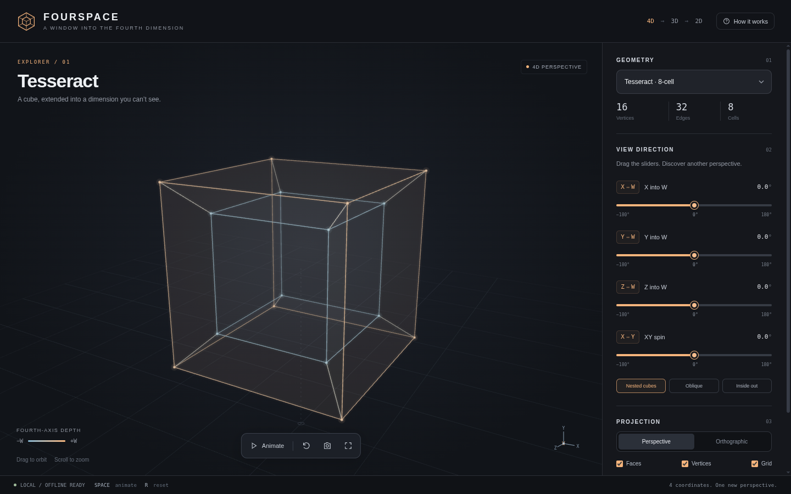

# Fourspace: 4D Visualizer

Explore projections of four-dimensional shapes, including the tesseract, 16-cell, 24-cell, 5-cell, hypersphere, and Clifford torus. Rotate them in 4D and view the resulting 3D projection from different angles.

Open [4d-space-visualizer.html](4d-space-visualizer.html) in a modern browser. It works offline and needs Canvas 2D support.

## Controls

- Use the sliders to rotate in the XW, YW, ZW, and XY planes.
- Drag to orbit the view; scroll or pinch to zoom.
- Choose a shape, projection, and display options in the side panel.
- Press **Space** to play or pause animation, **R** to reset, **S** to save an image, **F** for fullscreen, and **?** for the guide.
