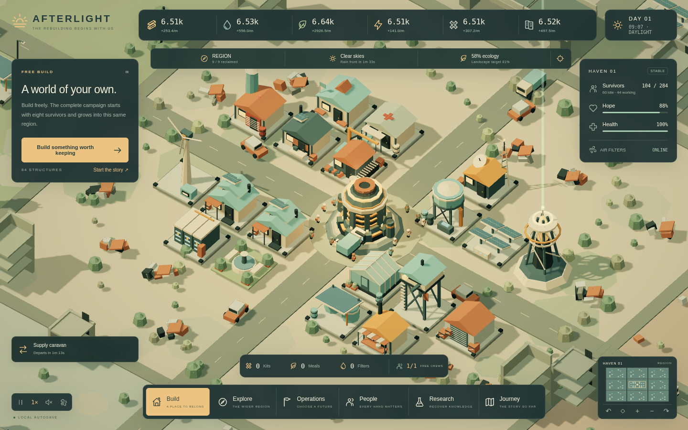
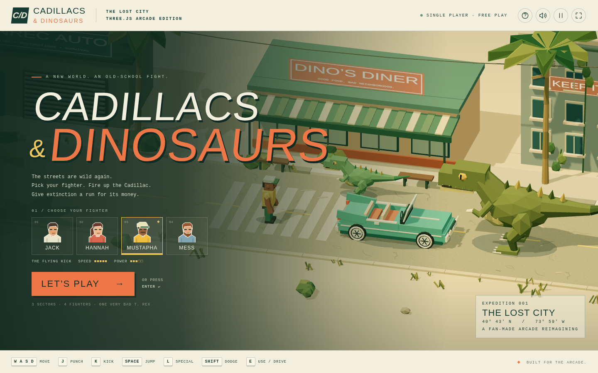
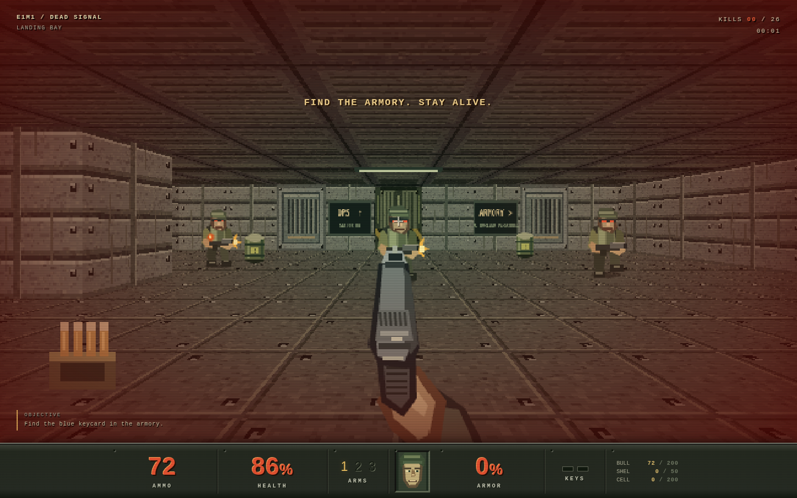
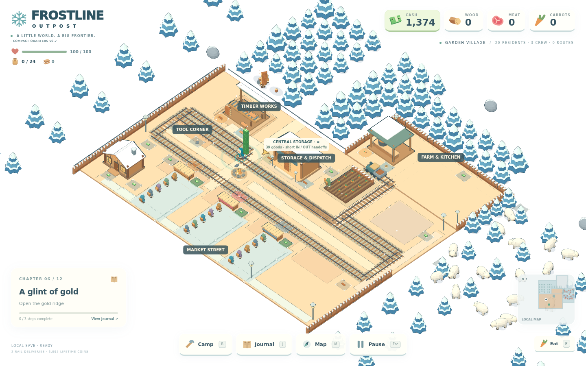
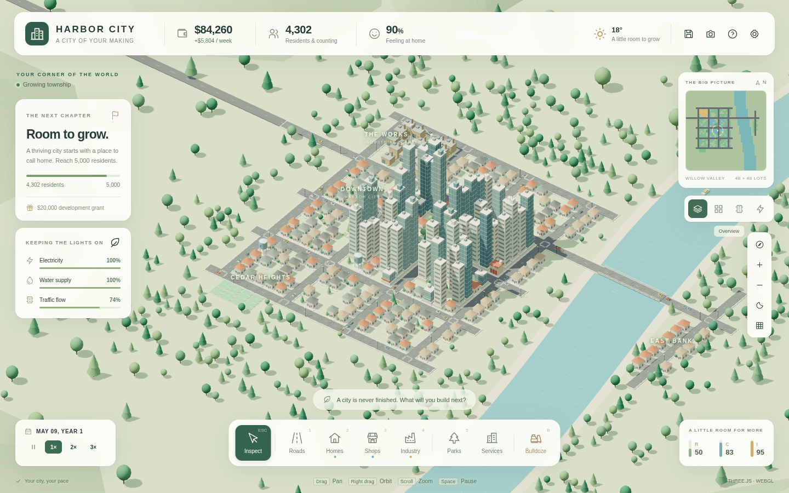

# Browser Games

Open a game in a modern browser. Each game shows its controls. Dead Signal needs a desktop keyboard and mouse.

## [Afterlight — Complete Edition](Afterlight-Complete.html)

Rebuild a settlement after the end of the world.

## [Cadillacs & Dinosaurs — The Lost City](Cadillacs-and-Dinosaurs.html)

Fight through a fan-made arcade adventure.

## [DOOM — Dead Signal](DOOM-Dead-Signal.html)

Explore and fight through a Doom-inspired facility.

## [Frostline](Frostline_v7.html)

Gather resources and grow a snowy outpost.

## [Harbor City](harbor-city.html)

Build and manage a city by the river.

## Connection and saves

Cadillacs & Dinosaurs needs internet access to load Three.js and a browser with WebGL. The other games can use built-in renderers offline; they also try to load Three.js for enhanced graphics.

Several games save progress or settings in browser storage. Clearing browser data can remove them; use the in-game export option for a backup where available.
