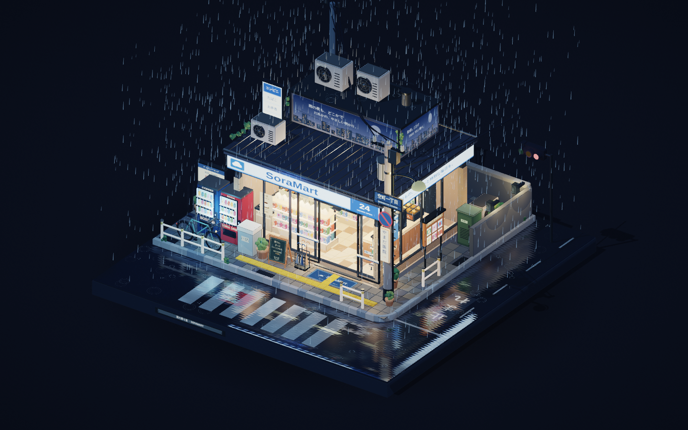

# SoraMart — Rainy Night

Explore this Japanese convenience store on a rainy street corner. A warmly lit, stocked interior sits on a square pedestal surrounded by wet roads, a crosswalk, vending machines, a bicycle, and other neighborhood details. Rainfall, dripping eaves, puddle ripples, sliding doors, and changing lights bring the miniature scene to life, with no characters or onscreen controls.

Open [SoraMart_Rainy_Night.html](SoraMart_Rainy_Night.html) in a modern browser. It needs JavaScript, WebGL, and internet access to load Three.js. No build or package installation is needed; models and textures are generated within the page.

## Controls

- Drag with the left mouse button or one finger to orbit; the arrow keys also rotate the view.
- Scroll, pinch, or press **+** / **−** to zoom.
- Drag with the right mouse button, hold **Shift** while dragging, or drag with two fingers to pan.
- Double-click, double-tap, or press **R** to reset the view.
- Click or tap the entrance doors to open them.
- Press **Space** to pause or resume scene animation, **A** to toggle automatic rotation, and **F** for fullscreen.

## Creation prompt

Original scene prompt

Use three.js, create a small rainy-night scene centered on a Japanese convenience store at a street corner. The entire scene should be viewable from a third-person perspective and feel like a miniature 3D diorama that can be freely orbited, zoomed, and panned — with absolutely no UI elements present. The ground should be a single, solid square pedestal upon which every element is built. The composition should be tight and clearly layered, evoking the feel of a small, meticulously crafted, collectible model. The visual style is 3D-to-2D cel shading (toon shading), with a strong Japanese anime atmosphere, clean and crisp materials, well-defined outlines, and soft yet richly layered nighttime neon color. The focal point is a Japanese convenience store at a street corner, positioned at the visual center of the pedestal. The exterior should feature typical Japanese street-corner elements, including: the store sign, large glass display windows, automatic sliding doors, a roof overhang and rain canopy, an entrance doormat, a vending machine, a bicycle, an umbrella stand, a trash can, a street lamp, a utility pole with overhead power lines, a road sign, a street-corner guardrail, a parking bay, a drainage gutter, a puddle-covered road, a reflective crosswalk, a narrow alley entrance, an outdoor AC unit, and a small bulletin or poster board. The street doesn't need to be large, but it should read clearly as a corner turn — the kind of quiet nighttime neighborhood intersection you'd see in Japanese animation. No characters or figures. However, the convenience store interior must be richly detailed and clearly visible through large glass windows. The interior should feature typical konbini fixtures: neatly arranged product shelves, beverage coolers, a bento section, onigiri (rice-ball) and snack displays, a checkout counter, a coffee machine, a magazine rack, promotional posters, interior lighting, ice freezers, an oden (hot-pot) counter, floor directional signage, and a storage cabinet or back-room door. The interior should feel bright, warm, realistic, and full of life, creating a striking contrast with the damp, dim rainy night outside — evoking the quintessential Japanese anime rainy-night atmosphere. Key art-style priorities: high-fidelity 3D modeling, clean cel-shaded rendering, crisp outline lines, refined yet restrained material layering, wet-reflective nighttime surfaces, warm interior lighting set against cool rainy-night street tones, and a strong slice-of-life anime feel. The overall mood should lean toward quiet, healing, and gently lonely — a touch of urban nighttime solitude that still feels warm — like a single frozen moment from a Japanese anime, rendered as a miniature street-corner diorama. Add subtle looping animations to bring the scene to life: continuous rainfall, water dripping from the eaves, gentle ripples in ground puddles, a faint flicker of the store sign or light box, the automatic doors occasionally sliding open and closed, rain streaks trailing down the glass, street puddles reflecting nearby lights, and subtle shifts in a distant traffic signal. The overall effect should be a still, exquisitely detailed 3D miniature world with just the right degree of subtle motion — emphasizing its core identity: cel-shaded 3D, anime aesthetic, rainy night, convenience store, street corner, and small-scale refinement.

